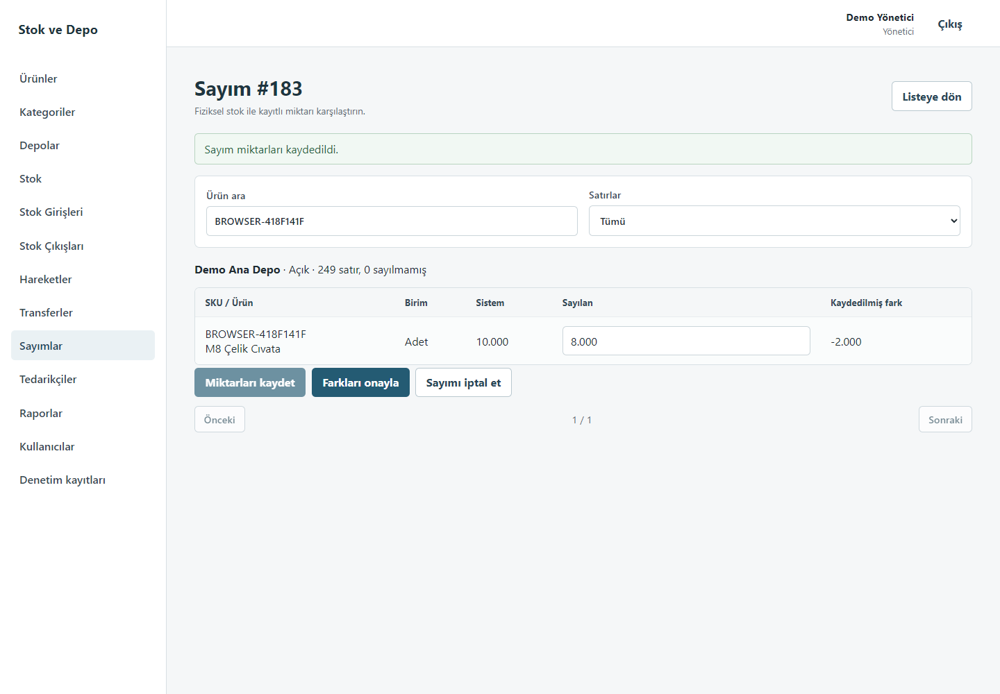
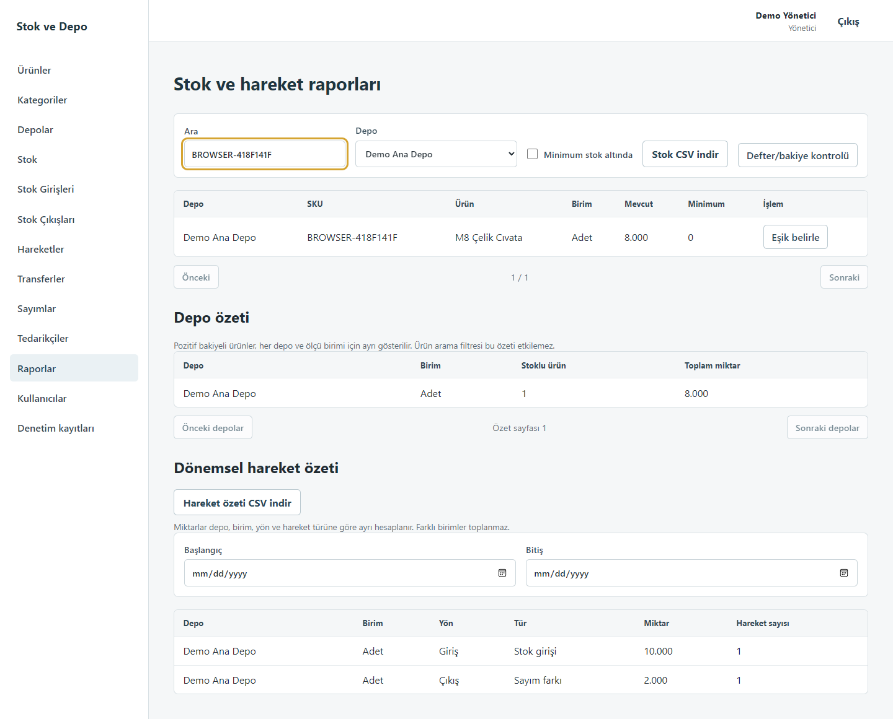

# Stok ve Depo Yönetimi

Küçük işletmelerin birden fazla depodaki ürünlerini, stok belgelerini,
transferlerini ve fiziksel sayımlarını takip eden yerel web uygulaması.
Arayüz Türkçedir. Çalışmak için ücretli API, bulut hesabı veya AI servisi gerekmez.

## Uygulanan özellikler

- Kullanıcı girişi, HttpOnly oturum cookie’si, CSRF/Origin denetimi ve giriş denemesi sınırı.
- Yönetici, depo sorumlusu ve görüntüleme rolleri; backend’de depo ataması kontrolü.
- Ürün, kategori, depo ve raf yönetimi; SKU/barkod doğrulaması ve pasifleştirme.
- Çok satırlı stok giriş/çıkış taslakları ve atomik onay.
- Transfer taslağı, sevk, teslim, taslak iptali ve yalnızca yoldaki transferin gerekçeli geri dönüşü.
- Depo başına tek açık sayım, stok snapshot’ı, miktar girişi, fark onayı ve iptal.
- Onaylı giriş/çıkış belgesinin yönetici tarafından tam ters hareketle düzeltilmesi.
- Tedarikçi yönetimi ve kullanıcı/depo atamaları.
- Depo/ürün bazında stok, minimum stok eşikleri, düşük stok filtresi ve dönemsel hareket özeti.
- Yetki/filtre kapsamını koruyan CSV; hücre formülü enjeksiyonuna karşı koruma.
- Denetim kayıtları ve salt okunur defter/bakiye uzlaştırması.

## Ekranlar

Aşağıdaki görüntüler yalnızca ayrı test veritabanındaki sentetik verilerle alınmıştır.




## Teknoloji

React 19.3, TypeScript 6.0.3, Vite 8.3.2, Fastify 5.12.5,
PostgreSQL, Prisma Client/CLI/adapter 7.10.1 ve pg 8.23.1.
Node.js 24.14–24.x gerekir; bağımlılıklar package-lock.json ile sabitlenir.
Modüler monolit; npm workspaces içinde apps/web ve apps/api.

## Yerel kurulum

1. Node.js 24 LTS ve PostgreSQL kurun. Docker zorunlu değildir.
2. Proje kökünde bağımlılıkları kurun:

```powershell
npm ci
if (-not (Test-Path .env)) { Copy-Item .env.example .env }
```

3. Yalnızca bu projeye ait yerel veritabanlarını hazırlayın:
   `stock_warehouse_local` ve `stock_warehouse_test`.
   Windows PostgreSQL 18 için aşağıdaki komutu kullanabilirsiniz.
   Farklı kurulumda yalnızca psql yolunu uyarlayın. Parola terminalde gizli sorulur.

```powershell
& 'C:\Program Files\PostgreSQL\18\bin\psql.exe' -X -h 127.0.0.1 -p 5432 -U postgres -d postgres -W -f .\apps\api\prisma\setup-local-postgres.sql
```

Betiği çalıştırmadan okuyun. Tanımsız/dolu hedefte durursa hiçbir veri silmeyin.
Aynı psql programıyla etkileşimli bağlantı açıp iki role ayrı parolalar belirleyin:

```text
\password stock_warehouse_app
\password stock_warehouse_migrator
\q
```

4. PowerShell’de parolaları gizli alarak yerel `.env` dosyasını yapılandırın:

```powershell
.\scripts\Configure-LocalDatabaseEnv.ps1
```

Uygulama bağlantısı kısıtlı `stock_warehouse_app`, migration bağlantısı ayrı
`stock_warehouse_migrator` rolünü kullanır. Gerçek `.env` Git’e eklenmez.
Manuel yapılandırmada bağlantı parolaları URL-encode edilmelidir.

5. Migration ve izinleri uygulayın, ardından sentetik kataloğu yükleyin:

```powershell
npm run db:migrate
npm run db:test:migrate
npm run db:grants
npm run db:seed
npm run auth:create-admin
```

İlk yönetici komutu parola girişini gizler, en az 14 karakter ister ve mevcut
hesabı değiştirmez. Seed varsayılan parola, stok hareketi veya bakiye üretmez.
Migration reset veya db push normal kurulum adımı değildir.

6. Uygulamayı başlatın:

```powershell
npm run dev
```

Web: http://127.0.0.1:5173 · API: http://127.0.0.1:3000.
Portlar başka bir süreçte kullanılıyorsa aynı projeyi ikinci kez başlatmayın.
Terminal açık kalmalıdır. 3000 başka bir projenin kullanımındaysa onu kapatmadan
PowerShell oturumunda farklı API portu seçebilirsiniz; proxy aynı portu izler:

```powershell
$env:PORT='3100'
npm run dev
```

Bu ayar yalnızca ilgili terminal oturumu içindir; `.env` değiştirilmez.
 Geliştirme localhost HTTP içindir; HTTPS yayınında
COOKIE_SECURE=true ve uygun APP_ORIGIN gerekir.

## Kontroller

```powershell
npm run db:validate
npm run build
npm run typecheck
npm run lint
npm test
npm run test:db
npm audit
npm audit --omit=dev
```

DB testleri yalnızca doğrulanmış yerel `stock_warehouse_test` hedefinde çalışır.
Hata enjeksiyonu trigger’larının çakışmaması için test dosyaları sırayla çalışır;
eşzamanlılık senaryoları kendi içlerinde ayrı PostgreSQL bağlantıları kullanır.
Değiştirilemez hareket/sayım fixture’ları test DB’de kalabilir. Eski kayıtlar
silinmez; her çalıştırmada benzersiz fixture kimlikleri kullanılır.
İlk yönetici oluşturma yarışı ayrıca rastgele, izole bir test şemasında sınanır;
yalnızca o çalıştırmanın oluşturduğu şema sonunda kaldırılır.

### Tarayıcı kabul testi

Playwright geliştirme bağımlılığıdır; ücretli servis kullanmaz.
Tarayıcı kurulumu gerekiyorsa bir kez `npx playwright install chromium` çalıştırın.

```powershell
npm run test:browser
```

Windows’ta kurulu Edge kullanılacaksa tarayıcı indirmeden:

```powershell
$env:BROWSER_CHANNEL='msedge'
npm run test:browser
```

Bu kontrol ayrı test veritabanı, 5174 web ve 3101 API portlarını kullanır.
Sentetik test kullanıcısını çalışma sonunda pasifleştirip oturumlarını kapatır.
Sayım 10→8, stok raporu, CSV, tedarikçi oluşturma, kullanıcı/denetim ekranları,
transfer sevk/teslim/geri dönüşü, belge terslemesi, sayfa yenileme ve çıkış
akışlarını kontrol eder. Diğer katalog satırları API ile
snapshot miktarlarında hazırlanır; seçilen ürünün miktarı arayüzden girilir.

## Veri bütünlüğü

StockMovement ekleme trigger’ı bakiyenin tek yazım yoludur. Hareketler silinmez
ve değiştirilmez; düzeltme ilişkili ters hareketle yapılır. Çok satırlı işlemler,
audit ve idempotency kayıtları aynı transaction içinde tamamlanır. Miktarlar
numeric(18,3), API değerleri decimal string’dir. Açık sayım ilgili depodaki stok
hareketlerini durdurur. Transferde yoldaki stok kullanılabilir stoğa eklenmez.
Depo kilitleri sabit sırayla alınır; ürün birim değişikliği sayım snapshot’ıyla
kilit altında sıralanır.

## Güvenlik ve sınırlar

2026-10-17 tarihinde Prisma 7.10.1 güncellemesi sonrası tam ve üretim bağımlılığı
audit sonuçları doğrulama raporunda kaydedilir. Önceki Prisma CLI bulguları
major düşüş veya zorlayıcı override yerine uyumlu yama güncellemesiyle giderildi.
Sıfır audit bulgusu bütün güvenlik risklerinin yokluğu anlamına gelmez.

Bu sürüm tek işletme ve yerel kullanım içindir. Kısmi transfer/teslim, teslim
sonrası iade, stok maliyetlendirmesi, muhasebe, lot/seri numarası, e-posta ile
parola sıfırlama ve internet yayını kapsam dışıdır. Onaylı belge terslemesi
belgenin tamamını düzeltir; orijinal onaylı belge geçmişte korunur.

Yönetici kullanıcı düzenlerken isteğe bağlı yeni parola belirleyebilir.
Kullanıcı düzenlemesi açık oturumları iptal eder; son aktif yönetici
pasifleştirilemez. Denetim görünümü yöneticilere açıktır. Raporlar sadece
atanmış depoları kapsar; farklı ölçü birimlerinin miktarları birbiriyle toplanmaz.
CSV stok dışa aktarımı en fazla 10000 satırdır; daha büyük sonuç filtrelenmelidir.

Manuel kabul senaryosu ve yedekleme: [Kullanım rehberi](docs/user-guide.md).
Doğrulama sonuçları: [Son kontrol raporu](docs/verification.md).
